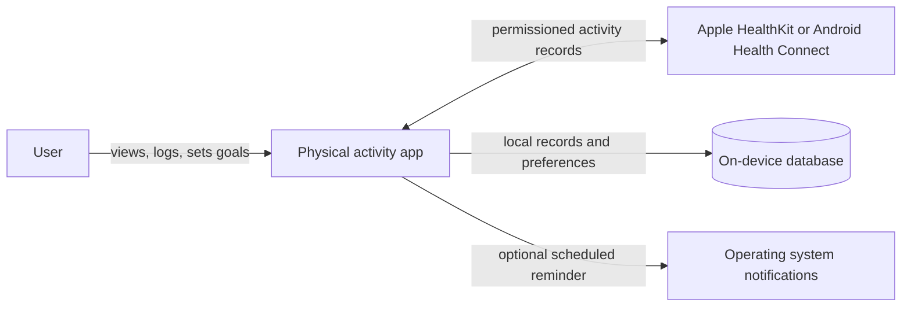
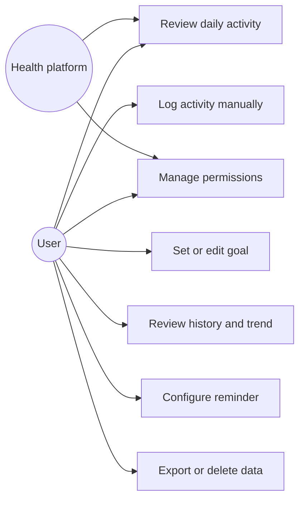
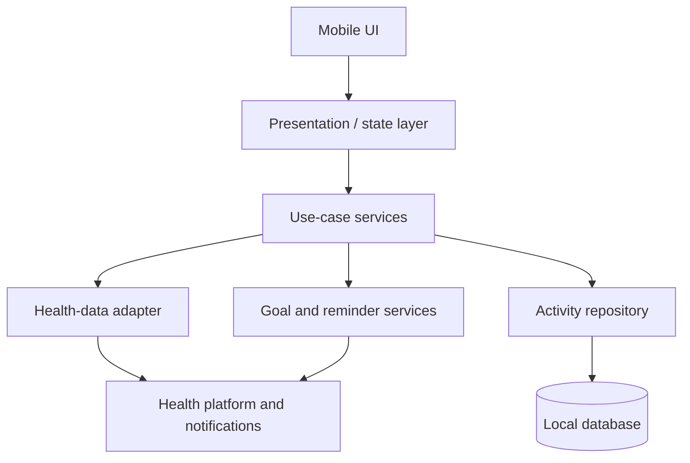

# Mobile Application for Tracking Physical Activity and User Health

A student engineering project for a mobile application that helps users record physical activity, review personal trends, and keep selected wellness information in one place. The project is in the analysis and design phase. The application is not a medical device and will not diagnose, treat, or replace advice from a healthcare professional.

> **Status:** Pre-defense planning draft for 24 October 2026. An aggregate summary of three exploratory interviews is recorded; detailed participant-level transcripts are withheld because publication consent has not been confirmed. The team confirmed the interviews took place in person on 20 October 2026. The sample is small, and participant eligibility for the proposed target group still needs confirmation. Team responsibilities are recorded as approved in `docs/research/decisions.md`; technical choices remain provisional. Supervisor review and runnable implementation remain pending.

## Project at a glance

| Item | Current information |
|---|---|
| Project title | Mobile Application for Tracking Physical Activity and User Health |
| Short name | Activity & Health Tracker (working name) |
| Project type | Mobile health and fitness application |
| Target users | Adults who want to record everyday activity and review personal wellness trends; the final user segment must be confirmed through interviews |
| Team members | Maratova Oryngul (SE-2426, 241840@astanait.edu.kz); Bekzhan Danelya (SE-2426, 240379@astanait.edu.kz); Kazbek Aigerim (SE-2426, 241633@astanait.edu.kz). Responsibilities are recorded in `docs/research/decisions.md`. |
| Supervisor | Kamila Tanyrbergenova (kamila.tanyrbergenova@astanait.edu.kz) |
| Repository | [GitHub: danelyaab/Diploma_Project](https://github.com/danelyaab/Diploma_Project) |
| YouTrack | [MoveWell Agile board](https://movewell.youtrack.cloud/agiles/204-1/current) |
| Current phase | Proposal, evidence gathering, requirements, architecture, and prototype planning |
| Selected technology | Not final. A comparison and provisional direction are recorded below. |

## Problem statement

People who want to understand their activity and day-to-day wellbeing may have to use separate tools for steps, exercise sessions, goals, and personal health notes. Existing applications offer many of these functions, but differ in supported devices, data sources, guidance, and privacy controls. Research also reports barriers such as inaccurate or incomplete measurements, poor contextual fit of reminders, cost, technical problems, and reluctance to share personal information.

The project investigates whether a focused mobile application can make activity records and selected user-entered wellness information easier to review, while making data sources, permissions, and limitations clear. Three exploratory discussions now inform preliminary requirements; the small sample does not validate population-wide needs.

## Target users and evidence status

The provisional user group is adults who use a smartphone and want to record everyday physical activity and review personal trends. An aggregate summary of three interviews is recorded in [`docs/research/interview-summary.md`](docs/research/interview-summary.md). The notes do not document age or smartphone eligibility checks; these must be confirmed before claiming that the target audience has been validated. Preferred platform and wearable requirements are also unsettled.

**User-validation status:** Three participant interviews are summarized, meeting the minimum count of three discussions. The team confirmed the date/method as 20 October 2026 / in person for all three. Detailed transcripts are withheld from the current files because publication consent is unconfirmed. Treat findings as exploratory, not representative; confirm participant eligibility before claiming target-group validation. One or two additional discussions are optional to broaden the evidence.

| Interview count | Recurring finding across these interviews | Requirements informed |
|---|---|---|
| 3 (P01–P03) | All three wanted manual activity entry and an easy view of activity; two explicitly described goals/progress, while the third emphasized statistics and longer-term history | FR-02, FR-03, FR-04, FR-05 |
| 3 (P01–P03) | Users described activities beyond automatically counted steps; the specific activity types differ | FR-02, FR-03 |
| 3 (P01–P03) | Reminder preferences vary, from an evening or low-activity prompt to little interest in reminders | FR-06 (optional/configurable) |
| 3 (P01–P03) | Health-data preferences differ; participants expressed limits around sharing personal or identity information | NFR-01; optional integrations require a separate decision |

These findings are a small-sample summary, not prevalence claims. Specific health-related requests and longer-term visualization preferences are not treated as shared requirements. The project will not prescribe health or weight-loss targets. Consent to publish detailed transcripts has not been confirmed; current files contain only aggregate findings. Earlier public commits still contain the former detailed version, so full removal from public history would require a separate repository-history decision.

### User discovery and evidence status

The required minimum of three discussions is recorded. If the team conducts one or two further discussions, add anonymized results to the same file and update this summary only where the evidence changes. A client agreement or process observation was not supplied.

| Evidence item | Status | Record |
|---|---|---|
| Potential-user interviews | 3 summarized; 20 Oct 2026 / in person; participant eligibility and publication consent to confirm | [`docs/research/interview-summary.md`](docs/research/interview-summary.md) |
| Client agreement or process observation | Not supplied; not needed if user interviews meet the brief | Add evidence only if obtained |
| Remaining assumptions | Target age range, accessibility needs, platform, and optional health/wearable integrations remain unconfirmed | Confirm with team and supervisor |

## Aim, objectives, and expected outcomes

**Aim:** Design and implement a mobile application that supports users in recording physical activity and reviewing selected wellness trends, with transparent data handling and measurable usability.

**Objectives:**

1. Review research and comparable applications to identify established approaches and limitations.
2. Interview potential users and distinguish verified needs from assumptions.
3. Define functional and non-functional requirements with priorities and acceptance criteria.
4. Compare mobile, data-access, storage, and integration alternatives and justify technology decisions.
5. Design the system architecture, key user scenarios, and interface prototype.
6. Implement a feasible minimum viable product (MVP), subject to the team's available time and skills.
7. Verify core functions and evaluate usability, data integrity, and activity-data consistency against a stated baseline.

**Expected outcomes:** A reviewed project proposal, literature and product comparisons, requirements specification, editable architecture diagrams, key-screen prototype, implementation plan, and—if the schedule permits—a runnable MVP with a verification report.

## Scope

### MVP scope

- Explain the app's purpose and request only the permissions needed for the feature the user selects.
- Record daily steps or activity sessions from a supported phone health platform when available; provide a clearly labeled manual entry path if integration is unavailable or declined.
- Let users set and edit a personal activity goal.
- Show a daily summary and a weekly activity history with units and data source labels.
- Let users optionally record a small set of self-selected wellness notes or measures. Exact measures will be selected after interviews and supervisor review.
- Provide optional, configurable reminders.
- Let users inspect, export, and delete their locally stored records.

### Out of scope for the first release

- Diagnosis, treatment, medication advice, or claims that the app improves clinical outcomes.
- Clinical risk scores, automated interpretation of vital signs, or emergency monitoring.
- Unvalidated AI or machine-learning health recommendations.
- Continuous GPS tracking, social leaderboards, or wearable hardware development.
- Cloud synchronization until its need, security requirements, and data-retention model are agreed.

## Literature review and source analysis

The supplied files contain **11 unique PDFs**. The two Tong et al. PDFs are exact copies (same SHA-256), so that publication is counted once. Including the previously shared Boulos and Yang article, this review covers **12 unique publications**. Ten are dated 2022–2026; the 2021 overview and 2017 COPD review are retained as earlier background. The core recent literature therefore exceeds the requirement of eight scientific publications, even if the CardioFit paper is treated only as supplementary evidence.

| Source | Type and method | Useful findings for this project | Critical limitations and how we will use it |
|---|---|---|---|
| [Alqahtani et al. (2025), *Scientific Reports*](https://doi.org/10.1038/s41598-025-22743-3) | Cross-sectional online survey of healthcare students in Riyadh; 523 responses, with 357 current tracker/app users in the reported user analysis | Identifies commonly used tracking features and reported barriers including cost, technical issues, inaccurate data, and privacy concerns | Self-reported, single-region, healthcare-student sample; perceived benefit is not causal evidence. Use to seed interview questions and candidate requirements, not to generalize prevalence. |
| [Aldossari et al. (2023), *Information Systems Management*](https://doi.org/10.1080/10580530.2022.2124559) | Empirical survey; 256 usable responses from mobile-fitness-app users | System quality and information quality are associated with goal-setting and goal-tracking use and reported achievement | Survey associations do not establish causation. Use to justify reliable, understandable tracking and goal workflows. |
| [Boulos & Yang (2021), *mHealth*](https://doi.org/10.21037/mhealth.2020.01.01) | Brief overview and categorization of mobile physical-activity planning/tracking apps | Describes GPS trackers, planners, exercise logs, daily-activity monitors, and game-based apps; highlights accuracy and privacy concerns | Older overview rather than a systematic review; product examples may be dated. Retain as foundational taxonomy and verify current products separately. |
| [Emish et al. (2023), *Sensors*](https://doi.org/10.3390/s23187917) | App design and technical evaluation; 20-day test on one iPhone 14 Pro Max | Demonstrates motion-aware GPS sampling, cloud storage, and a permissions-oriented interface | One-device evaluation; reported location metadata is not equivalent to ground-truth validation. The paper's use of “anonymization” for linkable identifiers should be read as pseudonymization. Use for architecture options, not accuracy claims. |
| [Figueroa et al. (2024 issue; online 2023), *Universal Access in the Information Society*](https://doi.org/10.1007/s10209-022-00962-z) | Mixed quantitative/qualitative feedback from 103 university students using step tracking and motivational messages for six weeks | Users valued concrete, positive feedback; poorly timed, discouraging, or motivation-mismatched messages were disliked | Convenience sample of students and messaging-focused intervention. Use for reminder tone, timing, and contextual design requirements. |
| [Martínez-García et al. (2017), *COPD: Journal of Chronic Obstructive Pulmonary Disease*](https://doi.org/10.1080/15412555.2017.1358257) | Systematic review of eight studies in people with COPD | Finds limited evidence for smartphone devices increasing activity and notes measurement-validity concerns | Older and disease-specific. Retain as foundational caution about evidence quality; do not generalize COPD intervention results to healthy adults. |
| [Papale et al. (2025), *IJERPH*](https://doi.org/10.3390/ijerph22091460) | Research protocol for stakeholder-informed app design for children | Offers a participatory design and group-concept-mapping process involving children, teachers, guardians, and activity specialists | This is a protocol: app effects have not yet been reported. Target population is children. Use the co-design method only if it fits our users; do not cite it as effectiveness evidence. |
| [Sousa Basto & Ferreira (2025), *BMC Health Services Research*](https://doi.org/10.1186/s12913-025-12489-z) | Qualitative interviews with 37 adults who already exercised and used monitoring apps | Highlights self-monitoring and historical results as valued motivations; shows user views on gamification vary | Purposive/snowball sample of existing app users and cross-sectional interviews. Findings are exploratory, not population estimates or causal effects. Use to motivate history and progress views. |
| [Stepanyuk et al. (2025), CEUR Workshop Proceedings](https://ceur-ws.org/Vol-3917/paper22.pdf) | Conference paper describing modular app design and a four-week pilot with two participants | Closest architecture example: tracking, planning, motivation, interface, synchronization, and local/cloud concerns | Two-person pilot cannot establish effectiveness or broad usability. The paper overstates privacy by treating pseudonymization as irreversible anonymization. Use as a design comparator only. |
| [Tong et al. (2022), *Digital Health*](https://doi.org/10.1177/20552076221115017) | Two-month, one-arm pre/post feasibility study of be.well; 23 university students | Supports testing preference-based suggestions, usability, engagement, and privacy expectations | Small student sample; no control group; cannot attribute step-count changes to the app. Use for feasibility measures and personalization requirements, not as proof of efficacy. The supplied duplicate PDF is counted once. |
| [Uyan et al. (2026), *Journal of Computer & Electrical and Electronics Engineering Sciences*](https://doi.org/10.51271/JCEEES-0032) | Describes CardioFit iOS, combining exercise, diet, and hydration tracking with Swift, Firebase, and K-means | Useful example of a unified dashboard and possible technology choices | The provided article does not clearly report a participant sample or a reproducible user-evaluation method supporting its satisfaction/effectiveness claims. The journal states that it uses double-blind review, but we will use this paper as a supplementary design example, not as a core evidence source. |
| [Vairavasundaram et al. (2022), *Axioms*](https://doi.org/10.3390/axioms11070346) | Recommendation-model paper using activity/physiological records from 533 people and an Android prototype | Illustrates clustering, step prediction, and adaptive activity planning | Model metrics do not demonstrate real-world health benefit; the model is more complex than the proposed MVP needs. Use for the technology comparison only. |

### Synthesis

Across the recent studies, the most defensible initial features are activity self-monitoring, historical progress, user-set goals, clear feedback, and configurable reminders. Personalization should be limited to transparent user preferences until evidence and privacy requirements support more advanced adaptation. Accuracy and data source should be visible. Gamification and social competition should remain optional because users do not respond to them uniformly.

The evidence does not establish that this project should use AI, GPS, or clinical metrics. It also does not yet identify our own users' needs. Those decisions depend on interviews and supervisor review.

## Existing-system comparison

This desk comparison uses official product documentation checked on 20 October 2026. Features depend on phone, wearable, region, permissions, and subscription. It is a product-scope comparison, not a controlled quality ranking.

| System | Activity tracking | Health/wellness breadth | Goals/history | Social or coaching | Data sources / limitations |
|---|---|---|---|---|---|
| Apple Health / Fitness | Steps and walking/running distance; Apple Watch adds activity and heart-rate measures | Broad health record across compatible apps and devices | Activity rings, trends, health history | Sharing features; prompts and coaching depend on Apple services/devices | Apple ecosystem; data availability varies by connected device and permissions |
| Samsung Health | Activity, steps, workouts | Sleep, nutrition, mindfulness, and selected vitals | Goals, summaries, history | Challenges and connected services | Feature availability varies by device, region, and connected wearable |
| Google Health / Fitbit | Steps, active minutes, workouts | Device-dependent sleep/heart-rate; user-entered food, water, and weight | Goals, activity history, trends | Fitbit community and paid coaching/features vary | Some measurements require compatible Fitbit hardware; account and platform availability can vary |
| Strava | GPS-based running, cycling, walking and other sport activities | Primarily exercise performance rather than a broad health record | Routes, records, progress | Strong social feed, clubs, segments; some functions are subscription-based | GPS and sport-focused; not a general health-tracking system |

**Criteria used:** activity capture, health breadth, goals/history, social/motivation, device dependence, privacy/data control. The proposed project should focus on a simple daily activity and personal-history experience, with optional self-entered wellness context, instead of replicating the full breadth of these products. Official references: [Apple Health](https://support.apple.com/en-us/108779), [Samsung Health](https://www.samsung.com/us/apps/samsung-health/), [Google Health/Fitbit](https://support.google.com/googlehealth/answer/14236510), and [Strava features](https://www.strava.com/features).

## Technology decisions

These are provisional decisions for the MVP and must be confirmed against team skills, target devices, supervisor feedback, and implementation time.

| Decision | Alternatives | Provisional choice and reason | Trade-off / decision gate |
|---|---|---|---|
| Mobile application framework | Native Swift + Kotlin; Flutter; React Native | Flutter, if the team can support Dart, for one shared codebase and consistent UI | Health data APIs may require native plugins. Reconsider if team skills or required sensors favor native development. Flutter and React Native both support native platform integration ([Flutter](https://docs.flutter.dev/platform-integration), [React Native](https://reactnative.dev/docs/native-platform)). |
| Activity data acquisition | OS health platforms; direct phone sensors/GPS; manual entry | OS health-platform integration where available, plus manual entry fallback; exclude continuous GPS from MVP | HealthKit and Health Connect require granular user permissions; users may deny or revoke access. Android/iOS support differs ([HealthKit permissions](https://developer.apple.com/documentation/HealthKit/authorizing-access-to-health-data), [Health Connect data types](https://developer.android.com/health-and-fitness/health-connect/data-types)). |
| Persistence | Local SQLite/Drift; Firebase Firestore; PostgreSQL + REST API | Local-first storage for the MVP; add export and deletion | Avoids needing a server and reduces data collection. No cloud sync or multi-device support unless interviews/team requirements justify it. |
| App structure / communication | Modular in-process services; REST API; GraphQL API | Modular in-process services, with repository interfaces around storage and health data | Small MVP does not need remote APIs; keep boundaries so cloud sync can be added later without embedding it in UI logic. |

## Requirements specification

Priorities: **Must** = required for the proposed MVP; **Should** = desirable if schedule and platform access permit. Acceptance criteria are proposed and require supervisor approval.

### Functional requirements

| ID | Priority | Requirement | Acceptance criteria |
|---|---|---|---|
| FR-01 | Must | Explain and request access to supported activity data | Before requesting OS permission, the app explains the data and purpose. If permission is denied or later revoked, the app remains usable and shows the source/access state. |
| FR-02 | Must | Record and edit an activity manually | User can enter activity type, date/time, and duration, and edit or delete a saved manual entry. Optional distance is recorded only for activity types where the user can supply it. Invalid or missing required values are rejected with a clear message. |
| FR-03 | Must | Show a daily activity summary | Summary shows today's available activity and labels each value's source (health platform, wearable/app sync, or manual). Missing data is shown as unavailable, never silently as zero; estimated values are identified as estimates. |
| FR-04 | Must | Set and edit a personal activity goal | User can choose a supported measure and their own target; the current summary displays progress toward that user-set goal. The app does not calculate weight-loss or medically suitable targets. |
| FR-05 | Must | Review activity history and a weekly trend | User can view at least seven days of saved activity; a missing day is visually distinguishable from a measured zero. Longer-term charts are a candidate enhancement pending scope and supervisor review. |
| FR-06 | Should | Configure a reminder | User can opt in, choose a reminder time, and disable it; no notification is sent without permission. |
| FR-07 | Should | Add optional user-entered wellness notes | User can skip the note; it is clearly self-reported and not presented as a diagnosis or sensor measurement. |
| FR-08 | Must | Export and delete personal data | User can request deletion of local records and export a readable copy; the app confirms before irreversible deletion. |

### Non-functional requirements

| ID | Priority | Requirement | Acceptance criteria |
|---|---|---|---|
| NFR-01 Privacy | Must | Minimize and protect personal data | Collect only fields required by selected features; explain permissions; never request identity documents; location and health data integrations are off until explicitly enabled; provide deletion/export path. |
| NFR-02 Reliability | Must | Work with missing permissions and intermittent connectivity | Core logging, history, and goals work offline; denied permissions do not crash or block manual entry. |
| NFR-03 Data integrity | Must | Preserve source, date, and units for values | Each imported/manual entry has a timestamp, unit, and source label; duplicate imports are handled without double counting. |
| NFR-04 Performance | Should | Keep common screens responsive | On the agreed test device, dashboard/history open within 2 seconds for at least 90% of 20 repeated trials with a populated 30-day history. |
| NFR-05 Accessibility | Should | Support readable, operable screens | Text scaling, adequate contrast, labels for controls, and non-color-only status cues are checked on the selected platform. |
| NFR-06 Battery | Must | Avoid unnecessary background work | No continuous GPS or continuous sensor polling in MVP; background sync/reminders are opt-in and platform-compliant. |
| NFR-07 Safety | Must | Avoid clinical claims | UI states that data are informational and not medical advice; app does not diagnose, prescribe, or imply that a goal is medically suitable. |

## Architecture

The diagrams below are editable Mermaid source embedded in this README. They are a proposed design and must be updated when the platform and data source are confirmed.

### System context



### Use cases



### Component diagram



### Separate editable diagrams and exports

- System context: [`system-context.mmd`](diagrams/source/system-context.mmd) · [SVG export](diagrams/exports/system-context.svg)
- Use cases: [`use-cases.mmd`](diagrams/source/use-cases.mmd) · [SVG export](diagrams/exports/use-cases.svg)
- Component diagram: [`component-diagram.mmd`](diagrams/source/component-diagram.mmd) · [SVG export](diagrams/exports/component-diagram.svg)

## UX and prototype

The following are text-level scenario sketches. A responsive, clickable browser prototype is available at [`docs/prototype/index.html`](docs/prototype/index.html); it is a UI concept only and does not connect to health data or store personal information.

1. **First launch and permissions:** welcome screen explains what the app does; user chooses whether to connect activity data. Permission request follows the explanation. If declined, offer manual logging and a settings link.
2. **Daily dashboard:** show today’s available measure, source, goal progress, and a clear “Log activity” action. Explain unavailable data without implying inactivity.
3. **Manual log and history:** select activity, duration, and date/time; save; return to a seven-day history where imported and manual entries are distinguishable.

## Verification and evaluation plan

This is a proposed plan, not a report of testing already performed. Get supervisor approval before recruiting participants or collecting personal data.

| Evaluation | Method and conditions | Measures / proposed success threshold | Baseline |
|---|---|---|---|
| Functional verification | Test each Must requirement on the agreed phone/OS; include permission allowed, denied, and revoked; airplane mode; empty history; duplicate import | All Must acceptance criteria pass; no crash or data loss in these scenarios | Requirement table above |
| Data consistency | For seven days, compare app-imported values with the same records visible in the OS health platform on one test account/device; record time zone, units, and source | At least 95% of eligible records match after documented unit/time conversion; all mismatches have an explainable cause | OS platform record view; this is an integration check, not a validation against clinical equipment |
| Usability | Moderated task walkthrough with 5–8 representative volunteers, subject to course/supervisor approval; tasks: find today’s summary, set goal, log activity, find a prior day | At least 90% task completion; record time, errors, and a short post-task ease rating; summarize issues rather than claim population-wide usability | First attempt without coaching; compare with a revised prototype if time allows |
| Performance | 20 repeated launches of dashboard/history on the agreed test phone with 30 days of sample records | 90th percentile screen display under 2 seconds; note device and OS version | Same device/build and dataset |
| Battery/background | One-hour foreground use and one-day idle observation with default MVP settings | No continuous GPS; record battery change and unexpected background activity | Device settings before/after; results are device-specific |

No health improvement or causal effect is claimed. The MVP evaluation assesses implementation correctness, data handling, and basic usability only.

## Project management, collaboration, and risks

### Proposed repository structure

```text
.
├── README.md
├── app/                 # application source (to be created)
├── docs/
│   ├── proposal.md
│   ├── literature-review.md
│   ├── requirements.md
│   ├── prototype/
│   └── evaluation-plan.md
├── diagrams/            # editable Mermaid/PlantUML source and exports
├── tests/               # test cases and automated tests
└── .gitignore
```

Use GitHub or GitLab with incremental commits. Create YouTrack tasks with IDs and link each task to a branch, commit, and merge request/pull request. Review changes before merging. Keep diagrams in editable text formats and export images for the presentation. Add `.gitignore` for build output, IDE files, local configuration, and secrets; never commit credentials or real participant health data. Proposed pre-defense tags: `pre-defense-1`, `pre-defense-2`, and `final-pre-defense`.

**Repository URL:** https://github.com/danelyaab/Diploma_Project. **YouTrack URL:** https://movewell.youtrack.cloud/agiles/204-1/current. **Supervisor:** Kamila Tanyrbergenova. The team approved the following responsibilities in [`docs/research/decisions.md`](docs/research/decisions.md): Maratova Oryngul — literature review, user research, and requirements; Bekzhan Danelya — repository coordination, architecture, and technology evaluation; Kazbek Aigerim — UX prototype and verification/evaluation.

### Proposed milestones for the 24 October 2026 checkpoint

| Date | Deliverable | Status |
|---|---|---|
| 20 Oct | Confirm scope, inventory sources, draft README and requirements | Drafted here; team confirmation pending |
| 21 Oct | Conduct 3–5 user discussions or obtain client agreement; revise assumptions | Three interviews summarized; date and in-person format confirmed; eligibility and publication consent remain to confirm; MOV-1 is Done |
| 22 Oct | Decide platform/data source; review the created repository, YouTrack tasks, prototype, and editable diagrams | Draft artifacts created; team and supervisor review pending |
| 23 Oct | Review requirements and evaluation plan with supervisor; address feedback; create checkpoint tag | Pending |
| 24 Oct | Present proposal, literature and comparisons, requirements, diagrams, prototype, evaluation plan, tasks, and progressive repository evidence | Target checkpoint; not yet completed |

### Risks and dependencies

| Risk | Effect | Mitigation / response |
|---|---|---|
| User needs are assumed rather than confirmed | Features may miss the target audience | Complete 3–5 short discussions or document client agreement; mark insights and assumptions separately |
| OS health API access differs by platform/device | Import may be unavailable or inconsistent | Choose a target platform early; keep manual entry as fallback; test denied/revoked permissions |
| Wearable/sensor measurements are inaccurate or incomplete | Misleading summaries | Display source and missing-data state; avoid medical interpretation; cite measurement limitations in literature review |
| Scope grows into GPS, nutrition, sleep, social, and AI features | Core MVP may not be ready | Keep MVP focused on activity, goal, history, and manual fallback; use decision gates for optional features |
| Personal health data is sensitive | Privacy or trust risk | Minimize collection, local-first storage, explicit permission, export/delete, no real user data in repo |
| Platform/framework unfamiliar to team | Schedule and integration risk | Confirm team skills before commitment; build a small permission/data-access proof of concept |
| Short schedule to checkpoint | Incomplete evidence and weak demonstration | Time-box comparison and prototype; maintain progressive commits; present limitations honestly |

### YouTrack task links

| Task | Owner | Due date | Status |
|---|---|---|---|
| [MOV-1 — user interviews and scope validation](https://movewell.youtrack.cloud/issue/MOV-1/Conduct-user-interviews-and-validate-project-scope) · [PR #3](https://github.com/danelyaab/Diploma_Project/pull/3) | Aigerim | Not set | Done in YouTrack. Three interviews summarized; participant eligibility and consent to publish detailed notes remain unconfirmed. |
| [MOV-2 — literature review](https://movewell.youtrack.cloud/issue/MOV-2/Prepare-literature-review-on-mobile-physical-activity-apps) | Danelya | 22 Oct 2026 | Done in YouTrack |
| [MOV-3 — prototype review](https://movewell.youtrack.cloud/issue/MOV-3/Review-clickable-MoveWell-prototype-and-confirm-key-user-flows) | Aigerim | 23 Oct 2026 | Open |
| [MOV-4 — editable architecture diagrams](https://movewell.youtrack.cloud/issue/MOV-4/Maintain-editable-architecture-diagrams-and-exported-views) | Danelya | 22 Oct 2026 | Open |
| [MOV-5 — supervisor review](https://movewell.youtrack.cloud/issue/MOV-5/Review-project-proposal-requirements-and-prototype-with-supervisor) | Oryngul | 23 Oct 2026 | Open |
| [MOV-6 — document project decisions](https://movewell.youtrack.cloud/issue/MOV-6/Document-project-decisions) · [PR #4](https://github.com/danelyaab/Diploma_Project/pull/4) | Danelya | 22 Oct 2026 | Open; review pending |

### Supervisor feedback and actions

No supervisor comments were included in the materials reviewed. Record actual feedback and its disposition here; do not fill this table with invented comments.

| Date | Feedback / requested change | Action taken | Status |
|---|---|---|---|
| Pending | Pending supervisor review | Pending | Open |

## Current readiness and next actions

The README covers the proposal, literature review, product and technology comparisons, draft requirements, editable architecture diagrams, UX scenarios, evaluation plan, and project risks. The following evidence or team-specific details remain to complete the checkpoint package:

- Confirm participant eligibility (adult smartphone users) without adding identifying details. Publication consent for detailed notes remains unconfirmed; the current public files contain only an aggregate summary.
- Keep MOV-1 recorded as Done according to YouTrack; the later consent and eligibility follow-up is documented separately and should not be presented as completed evidence.
- Complete MOV-6 through review of the decision record and this linked pull request; keep it open until its acceptance criteria are reviewed.
- Confirm the target user group, mobile platform, team skills, and provisional technology decisions with the supervisor.
- Review the clickable prototype and SVG diagram exports with the team and supervisor; record resulting changes.
- Review and merge the MOV-6 pull request after team review; create the checkpoint tag when the submission is ready.
- Record real supervisor feedback and the action taken.
- Once an app exists, add run instructions, environment requirements, and test results; no runnable implementation is represented as complete here.

## Repository Workflow

The repository is the project's main record from the first checkpoint through the final defense. It can be private, provided access is available to the team and supervisor, and to the committee before each pre-defense. Each student should use an individual account so contributions can be identified.

### Branching and Task Management

- The `main` branch serves as the reviewed baseline.
- Project work is organized in task branches named with the relevant YouTrack ID, for example, `DIP-23-database-schema`.
- YouTrack tasks include:
  - Owner
  - Expected outcome
  - Acceptance criteria
  - Deadline
- Branches, commits, and pull requests refer to the task ID.
- Completed work is linked back to the corresponding task.

### Pull Requests and Reviews

- Pull requests describe the change and how it was checked.
- Team members review one another's work.
- For individual contributions, the supervisor reviews significant changes at agreed checkpoints.
- Tasks are marked complete after their acceptance criteria have been met.

### Submission Tags

Submissions are identified by the following tags:

- `pre-defense-1`
- `pre-defense-2`
- `final-pre-defense`

Each tag refers to the submitted version.

Submission details include:

- Repository URL
- Submission tag
- Completed work
- Limitations
- Outstanding tasks

During the defense, the team can demonstrate:

- Connections between tasks and deliverables
- Review comments
- Contribution history
- Application setup and tests (when available)

## Setup, Execution, and Testing

The project does not yet have a runnable application or a finalized set of dependencies, so setup and test commands are not available.

Once the first runnable version is added, this section will include:

1. **Requirements**
   - Required SDK or runtime versions
   - Necessary development tools

2. **Installation**
   - Dependency installation instructions
   - Platform-specific configuration

3. **Execution**
   - Application launch commands
   - Expected execution results

4. **Testing**
   - Test commands
   - Expected test results

### Configuration and Security

- Configuration examples will use placeholder values.
- Secrets and sensitive credentials will not be stored in the repository.
## Documentation map

The analysis in this README provides the initial proposal, scope, literature review, system comparison, technology comparison, requirements, architecture draft, UX scenarios, and evaluation plan. As the repository is created, split and link the reviewed artifacts here:

- [`docs/project-proposal.md`](docs/project-proposal.md) — proposal and scope.
- `docs/literature-review.md` — source table and synthesis.
- `docs/comparisons/existing-systems.md` and `docs/comparisons/technology.md` — comparison details.
- `docs/requirements.md` — versioned requirements and acceptance criteria.
- `docs/architecture/` — editable diagram sources and readable exports.
- [`docs/prototype/index.html`](docs/prototype/index.html) — responsive, clickable concept prototype.
- `docs/evaluation-plan.md` — approved verification and evaluation plan.
- [`docs/research/interview-summary.md`](docs/research/interview-summary.md) — interview guide and preliminary aggregate summary of three interviews. Detailed transcripts are withheld pending consent; dates and in-person format were confirmed as 20 October 2026. Earlier public commits may retain prior transcript text.
- [`docs/research/decisions.md`](docs/research/decisions.md) — decision record for research evidence, responsibilities, scope, and technical choices.
- `config/` — safe configuration examples with placeholder values only.
- `app/` — component-organized application code and dependency definitions.
- `tests/` — automated and supporting test materials.

The prototype and architecture diagram source/export folders are included in this repository. The remaining planned document paths are not claimed to exist until their files are added.

## Supplied-file inventory and duplicate check

The file-level check found 12 supplied PDF files and 11 distinct PDF documents. The following two files are byte-for-byte identical (same SHA-256), so they represent one source in the 12-publication literature review:

- `tong-et-al-2022-a-personalized-mobile-app-for-physical-activity-an-experimental-mixed-methods-study.pdf`
- `tong-et-al-2022-a-personalized-mobile-app-for-physical-activity-an-experimental-mixed-methods-study (1).pdf`

The remaining distinct supplied PDFs map to these sources: `paper22.pdf` — Stepanyuk et al. (2025); `s41598-025-22743-3.pdf` — Alqahtani et al. (2025); `ijerph-22-01460-v2.pdf` — Papale et al. (2025); `s10209-022-00962-z.pdf` — Figueroa et al. (2024 issue; online 2023); `axioms-11-00346.pdf` — Vairavasundaram et al. (2022); `sensors-23-07917.pdf` — Emish et al. (2023); `EBSCO-FullText-10_20_2026 (2).pdf` — Aldossari et al. (2023); `s12913-025-12489-z.pdf` — Sousa Basto and Ferreira (2025); `EBSCO-FullText-10_20_2026 (1).pdf` — Uyan et al. (2026, CardioFit); and `EBSCO-FullText-10_20_2026.pdf` — Martínez-García et al. (2017). The Boulos and Yang (2021) overview was shared earlier as a link and is included as the twelfth, foundational publication; it is not one of these supplied PDFs.
